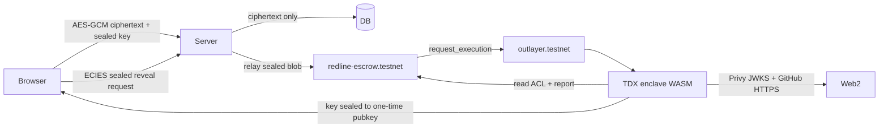

# Redline

Private vulnerability disclosure with automated NEAR bounties. A researcher seals a report in the browser. An OutLayer TDX enclave is the only place that ever holds the key. When the team funds an escrow and merges the agreed fix pull request, the contract pays out — after the enclave itself checks GitHub.

Live demo: https://redline-app-production-b0e6.up.railway.app

## The problem

Security disclosure still forces a hard choice. Email a PDF and hope the right person reads it. Post a public advisory and burn the patch window. Or trust a platform that stores your write-up in plaintext on someone else's server. Bounties add another trusted party: an arbiter who decides whether the fix "counts."

Researchers and teams need a path where the exploit stays sealed until the right people are verified, negotiation stays private, and payout does not depend on a human clicking "approve."

## The idea

OutLayer CEO [@zacodil](https://x.com/zacodil) sketched the core in a NEAR Hackathon post ([source](https://x.com/zacodil/status/2117283219364016192)):

> A NEAR contract holds the bounty. OutLayer checks GitHub inside the enclave: is the PR merged, and did the right account author it? If yes, the payout goes out. No arbiter and no trusted backend, just a verifiable check of a Web2 fact.

Redline takes that check and wraps a full disclosure product around it: sealed reports, verified invites, private negotiation, NEAR escrow, and automatic payout when the linked PR merges.

## What it is

- **Sealed reports.** AES-256-GCM ciphertext in the browser. The report key is ECIES-sealed to the enclave public key. The server stores ciphertext and the sealed blob only — never a plaintext key.
- **Verified invites.** The researcher invites a security contact by email, X, Telegram or GitHub. The invitee signs in with Privy; the enclave releases the key only after it checks the on-chain member list (identity hashes, with revoked members denied).
- **Private negotiation.** Terms and chat stay between the researcher and the redeemed invitee.
- **NEAR escrow.** The team funds `redline-escrow.testnet`. The contract holds the bounty until the enclave reports a merged PR.
- **In-enclave merge + author check.** The contract asks OutLayer to run `merge_check`. Inside the TEE the enclave calls GitHub and answers `merged` only when the PR is merged **and** the author matches the expected login bound for that report. Wrong author → `unknown` / no payout.
- **Timed disclosure.** If the team never funds, the researcher can publish after the disclosure deadline; the on-chain content hash is the evidence.

Tracks this fits: `privacy`, `security`, and `realworld`.

## Try it (do X → see Y)

1. Open https://redline-app-production-b0e6.up.railway.app and sign in (email / social via Privy).
2. Create a report with a title, severity, repo and markdown body → the app seals the body in your browser and registers the content hash on `redline-escrow.testnet`.
3. Invite a teammate → they redeem the link, sign in, and can decrypt the same report on a fresh device. An uninvited account gets 404; a revoked invitee is denied by the enclave.
4. Agree terms and fund escrow (testnet NEAR) → the bounty sits in the contract.
5. Link a fix PR in the reported repo and merge it under the expected GitHub login → the enclave merge check returns `merged` and the contract pays the researcher's payout account. No manual "claim" click is required once the poller sees the result.
6. Open `/disclosures` → paid / published reports appear publicly; sealed ones never do.

## NEAR and OutLayer

| Piece | Role |
| --- | --- |
| `redline-escrow.testnet` | Report registry, invite member hashes, escrow, OutLayer callbacks, payout / refund |
| `outlayer.testnet` | Runs the attested WASM worker (`request_execution`) |
| Enclave project | `redline-escrow.testnet/redline-enclave` |
| Enclave build (sha256) | `eee38f53a7ade0f8d7e8b0d0381e689a21b2c05b656408e6e700eda1ce8a1468` |
| Enclave public key | `04d810a6542b6d4cff3fd8ad01310dd0e2f8d897a14459f35d6b17506b2c7cb5ae58dfe2ee72ab790efb3863d241f6b6dd9c7e33bb6f284628e41233de4a6a6d78` (secp256k1, unchanged across rebuilds — derived from the keystore master) |
| Relay accounts | `researcher.redline-escrow.testnet`, `team.redline-escrow.testnet` (server-held keys that write ACL commits and pay for enclave calls; they never see report keys) |

Network: NEAR **testnet** only right now.

## Architecture



**Trust model (honest limits)**

- The enclave is the only component that can open a report key. Attestation is OutLayer / Intel TDX.
- The server never holds plaintext keys; it relays sealed blobs and stores ciphertext. A server operator with a live user Privy token could in principle ask the enclave for *that user's* key — the enclave still enforces the on-chain ACL for that identity.
- ACL commits (`invite_member` / `revoke_member`) are written by the relay accounts, not by end-user wallets.
- Wallet-login (non-Privy) users do not use the enclave key path.
- GitHub is read from inside the enclave for the merge/author decision; the server's GitHub read is a fee-saving pre-check only.

## Layout

| Path | What |
| --- | --- |
| `web/` | Vite + React 19 app (Privy, Tiptap, eciesjs, Tailwind) |
| `server/` | Express API: ciphertext store, ACL sync, enclave relay, payout poller |
| `contracts/escrow-contract/` | NEAR escrow (near-sdk Rust) |
| `enclave/` | OutLayer worker (`wasm32-wasip2`, Rust) |

## Run locally

```sh
cp .env.example .env
cd server && npm ci && npm run dev     # API on :8791
cd web && npm ci && npm run dev        # :5173, proxies /api
```

Contract and enclave (optional, for a full local stack):

```sh
cd contracts/escrow-contract && cargo near build
cd enclave && cargo test && cargo build --release --target wasm32-wasip2
```

Set `LEDGER_MODE=testnet`, `ESCROW_CONTRACT_ID`, `ENCLAVE_PUBLIC_KEY`, relay keys, and Privy app id for a live path. Without them the API can still run in preview mode for UI work.

## Tech stack

- Web: Vite, React 19, TypeScript, Tailwind, Phosphor, Tiptap, Privy, eciesjs, near-api-js
- Server: Express, zod, near-api-js
- Contract: near-sdk (Rust)
- Enclave: Rust WASI (`wasm32-wasip2`), ecies, p256 (Privy JWKS), OutLayer keystore secrets
- Hosting: Railway (app), NEAR testnet, OutLayer TDX

## Libraries and boilerplate

Allowed per the hackathon rules; listed here as baseline:

- Privy auth SDK
- near-api-js / near-cli-rs / near-sdk
- OutLayer CLI and agent runtime
- eciesjs (browser) and Rust `ecies` (enclave)
- Tiptap editor
- AgentMail (optional invite email delivery)

## License

MIT — see [LICENSE](./LICENSE).
