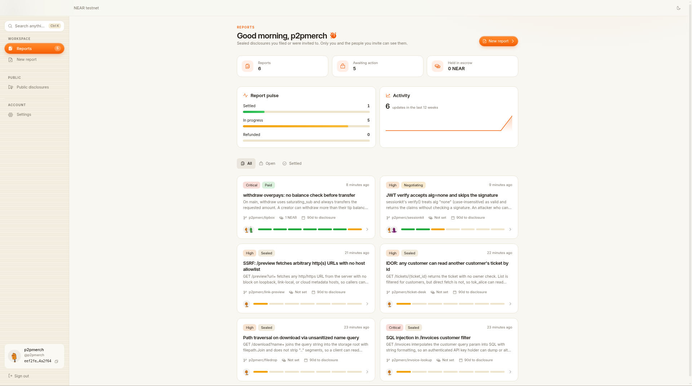
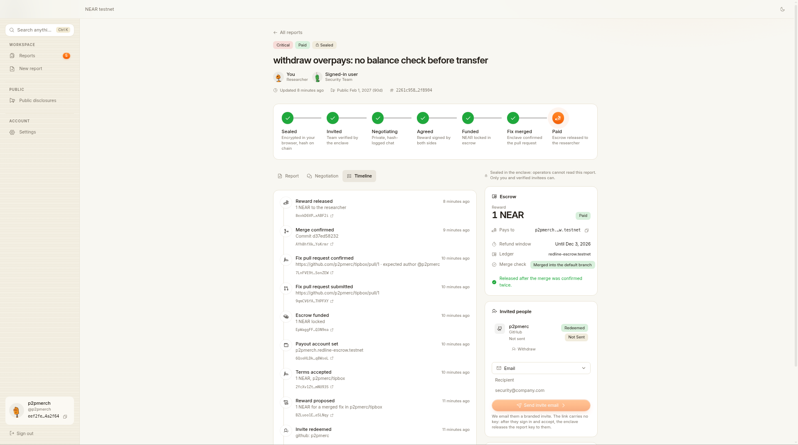
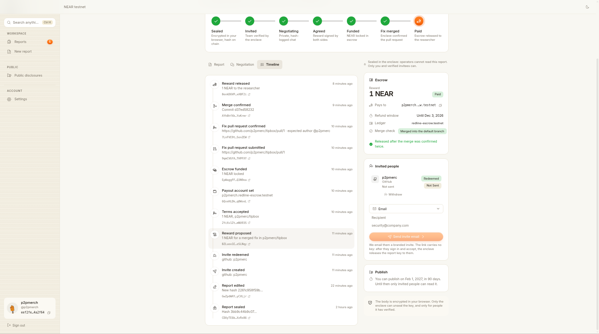
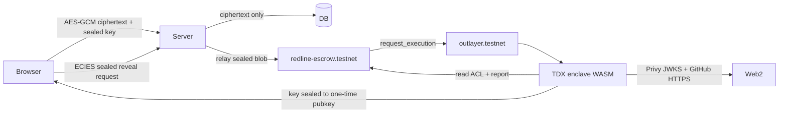

# Redline

Private vulnerability disclosure with automated NEAR bounties. A researcher seals a report in the browser. An OutLayer TDX enclave is the only place that ever holds the key. When the team funds an escrow and merges the agreed fix pull request, the contract pays out — after the enclave itself checks GitHub.

Live demo: https://redline-app-production-b0e6.up.railway.app

## The problem

Security disclosure still forces a hard choice. Email a PDF and hope the right person reads it. Post a public advisory and burn the patch window. Or trust a platform that stores your write-up in plaintext on someone else's server. Bounties add another trusted party: an arbiter who decides whether the fix "counts."

Researchers and teams need a path where the exploit stays sealed until the right people are verified, negotiation stays private, and payout does not depend on a human clicking "approve."

## The idea

OutLayer CEO [@zacodil](https://x.com/zacodil) sketched the core in a NEAR Hackathon post ([source](https://x.com/zacodil/status/2117283219364016192)):

> A NEAR contract holds the bounty. OutLayer checks GitHub inside the enclave: is the PR merged, and did the right account author it? If yes, the payout goes out. No arbiter and no trusted backend, just a verifiable check of a Web2 fact.

Redline takes that check and wraps a full disclosure product around it: sealed reports, verified invites, private negotiation, NEAR escrow, and automatic payout when the linked PR merges.

## What it is

- **Sealed reports.** AES-256-GCM ciphertext in the browser. The report key is ECIES-sealed to the enclave public key. The server stores ciphertext and the sealed blob only — never a plaintext key.
- **Verified invites.** The researcher invites a security contact by email, X, Telegram or GitHub. The invitee signs in with Privy; the enclave releases the key only after it checks the on-chain member list (identity hashes, with revoked members denied).
- **Private negotiation.** Terms and chat stay between the researcher and the redeemed invitee.
- **NEAR escrow.** The team funds `redline-escrow.testnet`. The contract holds the bounty until the enclave reports a merged PR.
- **In-enclave merge + author check.** The contract asks OutLayer to run `merge_check`. Inside the TEE the enclave calls GitHub and answers `merged` only when the PR is merged **and** the author matches the expected login bound for that report. Wrong author → `unknown` / no payout.
- **Timed disclosure.** If the team never funds, the researcher can publish after the disclosure deadline; the on-chain content hash is the evidence.

Tracks this fits: `privacy`, `security`, and `realworld`.

## Try it (do X → see Y)

1. Open https://redline-app-production-b0e6.up.railway.app and sign in (email / social via Privy).
2. Create a report with a title, severity, repo and markdown body → the app seals the body in your browser and registers the content hash on `redline-escrow.testnet`.
3. Invite a teammate → they redeem the link, sign in, and can decrypt the same report on a fresh device. An uninvited account gets 404; a revoked invitee is denied by the enclave.
4. Agree terms and fund escrow (testnet NEAR) → the bounty sits in the contract.
5. Link a fix PR in the reported repo and merge it under the expected GitHub login → the enclave merge check returns `merged` and the contract pays the researcher's payout account. No manual "claim" click is required once the poller sees the result.
6. Open `/disclosures` → paid / published reports appear publicly; sealed ones never do.

## For AI agents

Redline has a read-only JSON API at `/api/v1`. It needs no account, no API key and no SDK. Every response is JSON, CORS is open (`*`), nothing is cached by clients (`Cache-Control: no-store`), and any method other than `GET` returns `405`. There is also an `llms.txt` and a machine-readable manifest.

Live base URL: `https://redline-app-production-b0e6.up.railway.app` (NEAR testnet, `redline-escrow.testnet`).

| Endpoint | What it gives you |
| --- | --- |
| `GET /api/v1` | Index of the endpoints below. |
| `GET /api/v1/disclosures?status=paid&limit=20&offset=0` | Public list: id, title, repo, severity, bounty, PR URL, fund and payout tx hashes, links. |
| `GET /api/v1/disclosures/:id` | One public disclosure: the list fields plus summary, body (only if the researcher unsealed it), merge commit, proof (contract, content hash, enclave info) and a public timeline. |
| `GET /api/v1/reports/:id` | Any report, public or private. With no token you get metadata and hashes only. |
| `GET /api/v1/verify/:id` | Re-checks a public report live: the contract record, the GitHub merge, the fund transaction and the payout transaction. Limited to 20 calls a minute, cached for 60 s. |
| `GET /api/v1/leaderboard?limit=50&offset=0` | Researcher leaderboard, ranked by NEAR earned from fixed-and-paid reports (ties share a rank): handle, display name, avatar seed, total earned, disclosures, paid count, highest severity, last paid date. Only researchers with a public profile and at least one public disclosure appear. |
| `GET /api/v1/researchers/:handle` | One researcher's public profile (bio, skills, public links), rank, totals and all of their public disclosures in the same shape as the list endpoint, with PR and transaction links. Never includes emails or payout wallets. |
| `GET /llms.txt`, `GET /.well-known/redline.json` | Discovery for agents. |

### Copy-paste examples (run against the live app)

```bash
U=https://redline-app-production-b0e6.up.railway.app

# 1. What has been paid or published?
curl -s "$U/api/v1/disclosures?limit=5"

# 2. One disclosure with its proof and timeline
curl -s "$U/api/v1/disclosures/rl-6f0812c1a1a5"

# 3. A private report, no token: hashes only
curl -s "$U/api/v1/reports/rl-18048f44fdcc"

# 4. A wrong token is a JSON 401 (a valid token of a non-party is a JSON 403)
curl -s -H "Authorization: Bearer not-a-real-token" "$U/api/v1/reports/rl-18048f44fdcc"

# 5. Check the escrow, merge and payout yourself
curl -s "$U/api/v1/verify/rl-6f0812c1a1a5"

# 6. Researcher leaderboard and one researcher
curl -s "$U/api/v1/leaderboard"
curl -s "$U/api/v1/researchers/p2pmerch"

# 7. Discovery
curl -s "$U/api/v1"
curl -s "$U/llms.txt"
curl -s "$U/.well-known/redline.json"
```

Real responses (trimmed with `…`):

`GET /api/v1/disclosures/rl-6f0812c1a1a5`

```json
{
  "id": "rl-6f0812c1a1a5",
  "title": "SQL injection in /invoices customer filter",
  "repo": "p2pmerc/invoice-lookup",
  "severity": "critical",
  "status": "paid",
  "outcome": "fixed_and_paid",
  "bountyNear": 0.4,
  "pullRequestUrl": "https://github.com/p2pmerc/invoice-lookup/pull/1",
  "bodyPublished": false,
  "fundTxHash": "BvH8tWMu591KRtNFVoCBpPE7DQ35a9YuX4YS1EYdejJt",
  "payoutTxHash": "F5WfvycCBUzeGhXA8PYNqCjVsNGM9EFHeUif1KYnMd1H",
  "body": "",
  "bodyNote": "The researcher has not unsealed the body. It stays encrypted; only the summary and the payout are public.",
  "mergeCommit": "c871da40915b6251d2d318a7b78973211a003cbb",
  "proof": { "contractId": "redline-escrow.testnet", "contentHash": "1306f76b…c3af", "enclave": { "projectId": "redline-escrow.testnet/redline-enclave", "wasmSha256": "eee38f53…1468", "pinnedOnChain": true } },
  "timeline": [ … ]
}
```

`GET /api/v1/reports/rl-18048f44fdcc` (private, no token)

```json
{
  "access": "metadata_only",
  "report": {
    "id": "rl-18048f44fdcc",
    "stage": "negotiating",
    "severity": "high",
    "createdAt": "2026-11-03T07:10:49.926Z",
    "disclosureDeadline": "2027-02-01T07:10:49.926Z",
    "contentHash": "0138451eb4f985e4f63e74f7f9c21ed42b106db79f083c4eee5b8f4d0e3b297f",
    "ciphertextBytes": 2766,
    "hasSealedKey": true,
    "messageCount": 4
  },
  "onChain": { "contractId": "redline-escrow.testnet", "contractUrl": "https://testnet.nearblocks.io/address/redline-escrow.testnet" },
  "enclave": { "projectId": "redline-escrow.testnet/redline-enclave", "wasmSha256": "eee38f53…1468", "pinnedOnChain": true, … },
  "note": "This report is private. Title, summary, body, chat and parties are hidden. Send a Bearer token of a party to see the encrypted record."
}
```

`GET /api/v1/reports/rl-18048f44fdcc` with a bad token

```json
{ "error": "The bearer token is missing, expired or invalid.", "code": "invalid_token" }
```

`GET /api/v1/verify/rl-6f0812c1a1a5` (checks trimmed, captured live)

```json
{
  "id": "rl-6f0812c1a1a5",
  "verdict": "partial",
  "checks": [
    { "name": "onchain.content_hash", "ok": true, "detail": "the sealed ciphertext hash on chain equals the one served here" },
    { "name": "onchain.status", "ok": true, "detail": "chain says Paid, the app says paid" },
    { "name": "onchain.amount", "ok": true, "detail": "the agreed amount on chain matches the bounty" },
    { "name": "github.merged", "ok": null, "detail": "GitHub reports the pull request as unknown" },
    { "name": "tx.escrow_funded", "ok": true, "detail": "fund_escrow succeeded on redline-escrow.testnet" },
    { "name": "tx.payout", "ok": true, "detail": "claim_payout succeeded and a transfer of the bounty reached p2pmerch.redline-escrow.testnet" }
  ],
  "transactions": [
    { "kind": "payout", "txHash": "F5WfvycCBUzeGhXA8PYNqCjVsNGM9EFHeUif1KYnMd1H", "success": true, "signer": "researcher.redline-escrow.testnet", "methods": ["claim_payout"], "transfers": [{ "to": "p2pmerch.redline-escrow.testnet", "amountNear": 0.4 }], "verified": true }
  ]
}
```

`verdict` is `verified` when every check passes, `partial` when none failed but some could not be read (for example GitHub rate-limited the server, `ok: null`), and `mismatch` when a check fails. An agent should not trust the server's word: `fundTxHash` and `payoutTxHash` are NEAR testnet hashes you can look up on any explorer or RPC, and the enclave `wasmSha256` is the value the contract pins on chain.

Other errors are `404 not_public` (disclosure and verify only know public reports), `404 not_found`, `400 invalid_id` (ids look like `rl-0123456789ab`), `405 method_not_allowed`, `429 rate_limited` on `/verify`.

`GET /api/v1/leaderboard`

```json
{
  "total": 1,
  "limit": 50,
  "offset": 0,
  "ledgerMode": "testnet",
  "rankedBy": "totalEarnedNear (fixed-and-paid reports), then paid count, then disclosures, then handle",
  "researchers": [
    {
      "rank": 1,
      "handle": "p2pmerch",
      "displayName": "p2pmerch",
      "avatarSeed": "d41883251d3b4331",
      "totalEarnedNear": 2.35,
      "disclosures": 5,
      "paid": 5,
      "highestSeverity": "critical",
      "lastPaidAt": "2026-11-03T11:36:56.507Z",
      "links": {
        "profile": "https://redline-app-production-b0e6.up.railway.app/researchers/p2pmerch",
        "api": "https://redline-app-production-b0e6.up.railway.app/api/v1/researchers/p2pmerch"
      }
    }
  ]
}
```

`GET /api/v1/researchers/p2pmerch` (the `disclosures` array has one item per public disclosure; four are elided here)

```json
{
  "handle": "p2pmerch",
  "displayName": "p2pmerch",
  "bio": "I hack sometimes",
  "skills": [],
  "links": {
    "github": "https://github.com/p2pmerc"
  },
  "avatarSeed": "d41883251d3b4331",
  "joinedAt": "2026-11-03T06:59:53.023Z",
  "rank": 1,
  "totalEarnedNear": 2.35,
  "disclosures": [
    {
      "id": "rl-9a8bf23774fe",
      "title": "SSRF: /preview fetches arbitrary http(s) URLs with no host allowlist",
      "repo": "p2pmerc/link-preview",
      "target": "p2pmerc",
      "severity": "high",
      "status": "paid",
      "outcome": "fixed_and_paid",
      "bountyNear": 0.3,
      "pullRequestUrl": "https://github.com/p2pmerc/link-preview/pull/1",
      "researcher": "p2pmerch",
      "bodyPublished": false,
      "fundTxHash": "BZPSWj81RsPzJMViobunatJqMrP7JyLGPbnYXsYagSwV",
      "payoutTxHash": "Bjp5yq1oLCv3bH63pPe88Gq7FFqDNjyhBH8h5o4hxBJk",
      "timestamps": {
        "createdAt": "2026-11-03T07:16:25.471Z",
        "fundedAt": "2026-11-03T10:39:48.552Z",
        "paidAt": "2026-11-03T11:36:56.507Z",
        "listedAt": "2026-11-03T11:36:56.507Z"
      },
      "links": {
        "self": "https://redline-app-production-b0e6.up.railway.app/api/v1/disclosures/rl-9a8bf23774fe",
        "verify": "https://redline-app-production-b0e6.up.railway.app/api/v1/verify/rl-9a8bf23774fe",
        "page": "https://redline-app-production-b0e6.up.railway.app/disclosures/rl-9a8bf23774fe",
        "fundTx": "https://testnet.nearblocks.io/txns/BZPSWj81RsPzJMViobunatJqMrP7JyLGPbnYXsYagSwV",
        "payoutTx": "https://testnet.nearblocks.io/txns/Bjp5yq1oLCv3bH63pPe88Gq7FFqDNjyhBH8h5o4hxBJk",
        "pullRequest": "https://github.com/p2pmerc/link-preview/pull/1"
      }
    },
    "\u2026"
  ],
  "paid": 5,
  "highestSeverity": "critical",
  "lastPaidAt": "2026-11-03T11:36:56.507Z",
  "ledgerMode": "testnet",
  "profilePage": "https://redline-app-production-b0e6.up.railway.app/researchers/p2pmerch"
}
```

The same data is browsable at https://redline-app-production-b0e6.up.railway.app/leaderboard and https://redline-app-production-b0e6.up.railway.app/researchers/p2pmerch.

### Security model: what a caller can and cannot see

- **Anonymous caller, public report** (`paid` or `published`): title, summary, repo, severity, bounty, PR URL, tx hashes, merge commit, public timeline and proof fields. The body is empty unless the researcher unsealed it after the disclosure deadline.
- **Anonymous caller, private report**: only `id`, `stage`, `severity`, `createdAt`, `disclosureDeadline`, the ciphertext hash and size, whether a sealed key exists, a message count and the enclave info. Title, summary, parties, chat and body are hidden, so an id alone reveals nothing about what is wrong or in which product.
- **Wrong or expired token**: `401 invalid_token`. **Valid token that is not a party to the report**: `403 forbidden`. The same private metadata is never leaked through the error.
- **A party's token**: the encrypted record. Even then the API never returns the report key, the plaintext, or invitee emails (invite handles are shown as "Security team"). Plaintext only comes out of the OutLayer TEE enclave after the contract confirms the caller is a listed party; the key is sealed to the enclave public key, and the server never holds it.
- **Leaderboard and researcher profiles**: built only from public reports (`paid` or `published`) and the researcher's public profile (handle, display name, bio, skills, links, avatar seed). Earnings count fixed-and-paid reports only. Emails, payout wallets, private reports and report ids that are not public are never included.
- The API cannot write. There are no POST routes under `/api/v1`, so an agent cannot fund, merge, claim or publish anything through it.
- Everything money-related is checkable off-platform: the contract `redline-escrow.testnet` (`get_report`, `get_config`) and the explorer links in each response.

## Screenshots

A real report taken all the way through on testnet: sealed, funded, fix PR merged, paid by the enclave check.

**Dashboard: six reports across every status**



**Report progress: funded, fix merged, paid**



**Full timeline, from seal to payout**



## NEAR and OutLayer

| Piece | Role |
| --- | --- |
| `redline-escrow.testnet` | Report registry, invite member hashes, escrow, OutLayer callbacks, payout / refund |
| `outlayer.testnet` | Runs the attested WASM worker (`request_execution`) |
| Enclave project | `redline-escrow.testnet/redline-enclave` |
| Enclave build (sha256) | `eee38f53a7ade0f8d7e8b0d0381e689a21b2c05b656408e6e700eda1ce8a1468` |
| Enclave public key | `04d810a6542b6d4cff3fd8ad01310dd0e2f8d897a14459f35d6b17506b2c7cb5ae58dfe2ee72ab790efb3863d241f6b6dd9c7e33bb6f284628e41233de4a6a6d78` (secp256k1, unchanged across rebuilds — derived from the keystore master) |
| Relay accounts | `researcher.redline-escrow.testnet`, `team.redline-escrow.testnet` (server-held keys that write ACL commits and pay for enclave calls; they never see report keys) |

Network: NEAR **testnet** only right now.

## Architecture



**Trust model (honest limits)**

- The enclave is the only component that can open a report key. Attestation is OutLayer / Intel TDX.
- The server never holds plaintext keys; it relays sealed blobs and stores ciphertext. A server operator with a live user Privy token could in principle ask the enclave for *that user's* key — the enclave still enforces the on-chain ACL for that identity.
- ACL commits (`invite_member` / `revoke_member`) are written by the relay accounts, not by end-user wallets.
- Wallet-login (non-Privy) users do not use the enclave key path.
- GitHub is read from inside the enclave for the merge/author decision; the server's GitHub read is a fee-saving pre-check only.

## Layout

| Path | What |
| --- | --- |
| `web/` | Vite + React 19 app (Privy, Tiptap, eciesjs, Tailwind) |
| `server/` | Express API: ciphertext store, ACL sync, enclave relay, payout poller |
| `contracts/escrow-contract/` | NEAR escrow (near-sdk Rust) |
| `enclave/` | OutLayer worker (`wasm32-wasip2`, Rust) |

## Run locally

```sh
cp .env.example .env
cd server && npm ci && npm run dev     # API on :8791
cd web && npm ci && npm run dev        # :5173, proxies /api
```

Contract and enclave (optional, for a full local stack):

```sh
cd contracts/escrow-contract && cargo near build
cd enclave && cargo test && cargo build --release --target wasm32-wasip2
```

Set `LEDGER_MODE=testnet`, `ESCROW_CONTRACT_ID`, `ENCLAVE_PUBLIC_KEY`, relay keys, and Privy app id for a live path. Without them the API can still run in preview mode for UI work.

## Tech stack

- Web: Vite, React 19, TypeScript, Tailwind, Phosphor, Tiptap, Privy, eciesjs, near-api-js
- Server: Express, zod, near-api-js
- Contract: near-sdk (Rust)
- Enclave: Rust WASI (`wasm32-wasip2`), ecies, p256 (Privy JWKS), OutLayer keystore secrets
- Hosting: Railway (app), NEAR testnet, OutLayer TDX

## Libraries and boilerplate

Allowed per the hackathon rules; listed here as baseline:

- Privy auth SDK
- near-api-js / near-cli-rs / near-sdk
- OutLayer CLI and agent runtime
- eciesjs (browser) and Rust `ecies` (enclave)
- Tiptap editor
- AgentMail (optional invite email delivery)

## License

MIT — see [LICENSE](./LICENSE).
